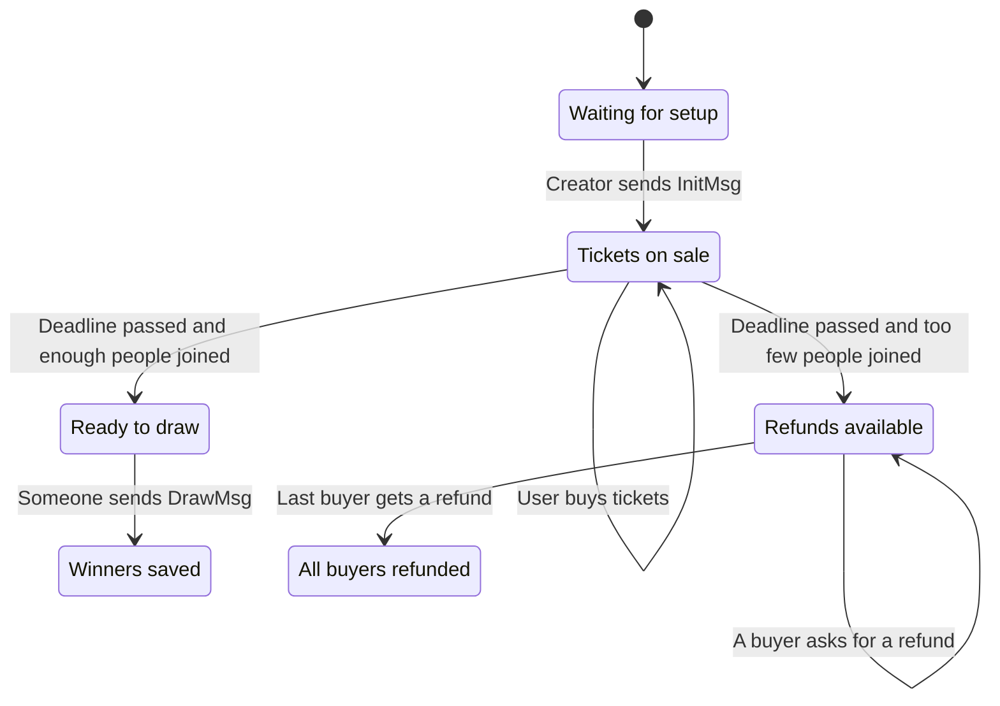

# 1. Lottery states

A lottery has a few main stages. The contract checks its saved data and the time to decide which actions are allowed.

“Enough people joined” means both the ticket total and the number of different buyer wallets meet the contract's minimum rules. These rules are set by `MIN_TICKETS` and `MIN_PLAYERS` in the Tolk code. Both minimums are twice the winner count.

## Before ticket sales

The starting data contains the creator's wallet address and a deployment ID. The contract waits for an `InitMsg` from that creator.

The message gives the sales deadline. After checking the sender and deadline, the contract saves the lottery settings and opens sales.

## While tickets are on sale

A buyer sends a ticket count and coins. The contract checks the deadline, ticket limits, and payment. If the request is accepted, it saves the tickets under the buyer's wallet address.

Several tickets from the same wallet still count as one player.

## After the deadline

There are two paths:

- Enough tickets and different buyers: someone can ask the contract to choose winners.
- Too few tickets or different buyers: each buyer can ask for their ticket money back.

Time passing does not send a message. A user must run `draw` or `refund`. Selling every ticket also does not start the draw early.

Buying is allowed at the exact deadline. Drawing and refunds are allowed only after it. The contract checks the time when the transaction runs, so a purchase sent just before the deadline may arrive too late.

## After a draw or refund

The contract saves the selected winners and sends prize messages. The creator also receives a fee. Transfer fees can reduce what recipients receive.

A buyer can get a refund only once. After it, the contract removes that buyer's refundable ticket count.

`prizePool` is a saved accounting value, not the wallet balance of the contract. `ticketsSold` counts all tickets issued, even after refunds.

This contract has no command to restart a lottery. Deploy a new lottery for another round.

Next: [User interactions](02-user-interactions.md).
