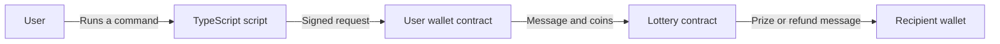
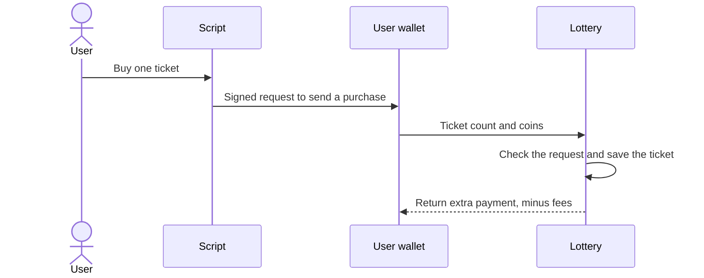

# 2. How users interact with the contract

A user runs a command in the terminal. This starts a TypeScript script on their computer. The script prepares a message and sends a signed request to their wallet contract. That wallet sends the message to the lottery.

The lottery code runs on the blockchain when its message arrives. The TypeScript script helps the user talk to that code.



The scripts use an RPC service to reach the blockchain. RPC is the connection used to send requests and read results. It is left out of this diagram to keep the main steps clear.

## Who can do what?

| Role | Actions |
| --- | --- |
| Creator | Deploy and initialize the lottery; receive the creator fee |
| Buyer | Buy tickets; ask for a refund when refunds are allowed |
| Any funded wallet | Ask for a draw when the draw is allowed |
| Anyone reading through RPC | Read the lottery information without signing |

The creator has no special permission to choose when a draw is allowed. The contract checks the same draw rules for everyone.

## Buying a ticket

For example:

```sh
npm run lottery -- buy 1
```



The diagram shows an accepted purchase. If a check fails, the contract rejects the request instead of saving a ticket. A failed request can still cost fees.

The lottery uses the sending wallet address to identify the buyer. It does not receive the user's recovery words or private key.

The wallet and lottery process separate transactions. A wallet sending a message does not prove that the lottery accepted it. Check the lottery transaction in the explorer, or read the ticket data.

## Reading information

```sh
npm run lottery -- info
```

This command asks RPC to run the lottery's read functions, called getters. It shows the saved settings and ticket totals.

It needs no signature and spends no coins from your wallet. It does not change the lottery.

## Drawing winners or asking for a refund

After the deadline:

- Run `npm run lottery -- draw` if the minimum ticket and player rules are met.
- Run `npm run lottery -- refund` if refunds are available. Use the wallet that bought the tickets.

One refund request covers all refundable tickets owned by that wallet. A draw request asks the contract to select winners; the caller does not automatically win.

Both commands send a message and coins. They do not run automatically after the deadline.

Next: [Build and deploy](03-code-and-storage.md).
