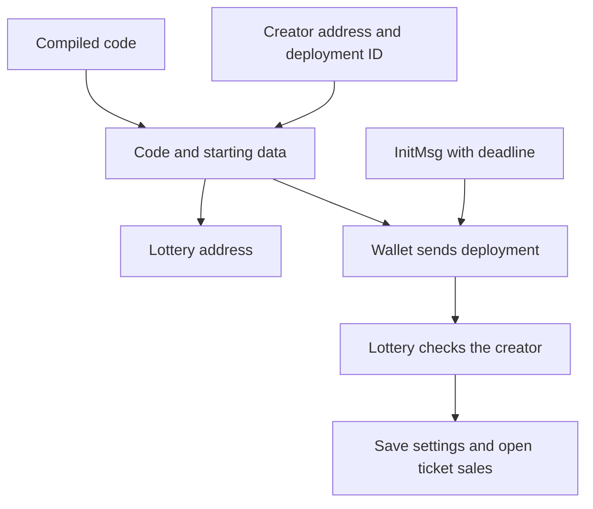

# 3. Build and deploy

There are two main steps: build the code on your computer, then deploy it to the blockchain.

## Build the code

```sh
npm run build
```

The compiler turns `Lottery.tolk` into code that the blockchain can run.

TON runs contracts using **TVM**, the TON Virtual Machine. Think of TVM as the engine that runs contract instructions.

The build saves the code in a **BOC** file. BOC means “Bag of Cells”. A cell is a small container for blockchain data. A BOC file saves one or more connected cells.

## Deploy the contract

```sh
npm run deploy
```

The deployment script prepares:

| Part | What it contains |
| --- | --- |
| Contract code | The compiled lottery program |
| Starting data | The creator's wallet address and a deployment ID |
| `InitMsg` | The deadline for buying tickets |

The code and starting data together are called **StateInit**. They determine the contract address. A new deployment ID changes the starting data, so it gives a new address.



## Creator, signer, and sender

These names describe different jobs:

| Name | Meaning in this project |
| --- | --- |
| Creator | The wallet address allowed to initialize the lottery and receive its fee |
| Signer | The script code that uses a private key to sign a wallet request |
| Sender | The wallet that sends a message to the lottery |

Our deploy script uses one wallet for these jobs. It reads the recovery words from `.env` and prepares that wallet and its sender.

Then it does the following, in order:

1. Put `wallet.address` into the starting data as the creator. This happens on your computer.
2. Prepare `InitMsg` with the deadline.
3. Sign a wallet request and send it. The wallet forwards the starting code, data, and `InitMsg` to the new lottery address.
4. The lottery checks that the sending wallet address matches the creator in the starting data.
5. If the checks pass, the lottery saves its normal storage: creator, deadline, and empty ticket lists.

So the starting data and `InitMsg` travel together in the deployment message. They are prepared before sending and processed during the deployment transaction. The creator address is already in the starting data when the contract checks the message.

The private key stays in the script. The wallet checks the signature. The lottery checks the wallet's address. The lottery never needs the private key.

## What gets saved later?

When someone buys tickets, the contract saves which wallet owns them and updates the ticket totals. It also tracks the ticket money as `prizePool`.

When someone asks for a draw or refund, the contract reads this saved data to check whether that action is allowed.

The TypeScript wrapper in [wrappers/Lottery.ts](../wrappers/Lottery.ts) builds these messages and reads getter results. Its getter names match the Tolk contract, so you can find the same function on both sides.
